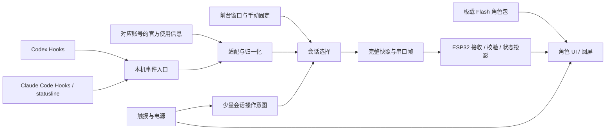

# 系统、数据源与会话状态

## 数据通路

电脑负责平台差异；设备负责呈现。Hook 入口只抽取白名单元数据，队列投递后退出；建议 50 ms 内完成、200 ms 硬上限。入口不可等待串口、网络或动画完成。服务未运行时快速返回，不能把徽章故障扩散到 Agent。

## 数据接入矩阵

| 客户端/指标 | 首选来源 | 不能得到时 |
| --- | --- | --- |
| Codex 生命周期、模型 | 官方 Hooks，先检测本机版本支持的事件与字段 | capability=false，显示同步能力不足；不猜忙闲 |
| Codex 额度 | 官方 App Server 的账号 rate limits / usage 能力，账号一致性核验 | 额度未知；不把 API 账户余额当订阅配额 |
| Claude Code 生命周期 | 官方 Hooks | 保留客户端主题，状态未知或手动演示 |
| Claude Code 型号、上下文、用量 | statusline JSON；不破坏原有 statusline 输出 | 缺字段保持 null，等待下一次可靠更新 |
| 前台应用 | Windows 前台窗口与所属进程 | 只能定位客户端，通常不能唯一定位会话 |
| 电池、电源、充电 | AXP2101 的板级读取 | 无电池 / USB 供电 / 读数未知分别展示 |

Codex 的 hooks、App Server 是不同入口。单独启动的新 App Server 进程不意味着能够订阅正在运行的桌面会话。安装适配器前要验证实际宿主的支持范围；不可为了监控而创建新对话、重放用户提示或恢复另一会话。账号查询必须与正在显示的账号及工作区对应。[Codex Hooks](https://learn.chatgpt.com/docs/hooks)、[App Server](https://learn.chatgpt.com/docs/app-server)

Claude Code 的 hooks 提供生命周期，statusline 提供会话信息；套餐、版本和更新时机可能导致部分额度字段缺失。将窗口标识、使用百分比、重置时间按返回值归一化，不能假设所有客户端都有相同的额度窗口。[Hooks](https://code.claude.com/docs/en/hooks)、[Statusline](https://code.claude.com/docs/en/statusline)

Hook 配置只在后续 G4 接入阶段合并安装，保留原条目，记录变更与卸载路径。Codex 原生信任流程由宿主完成。本轮没有安装 Hook，也没有读取账号凭据。

## 电脑端状态机

每个会话保留：session_id、turn_id、actual_model、活动工具 ID 集合、子 Agent ID 集合、等待原因、最后事件 ID、来源能力、最近活动时间。父子事件必须标注 parent_id。事件去重 key 为 adapter_instance + event_id；没有上游事件 ID 时，入口生成唯一 ID，但不能把两次同名工具调用误去重。

| 事件 | 更新规则 |
| --- | --- |
| turn_start | 新回合覆盖旧回合收尾状态，清理上一回合集合；phase=working |
| tool_start | 按 tool_call_id 加入集合；无等待时 phase=tool |
| tool_end | 只移除对应 ID；其他工具仍在时保持 tool |
| waiting / PermissionRequest | phase=waiting，原因单独保存；优先于工作动效 |
| resume / 后续明确执行事件 | 解除等待；按仍活动的工具集合恢复 tool 或 working |
| subagent_start / end | 更新对应集合；子 Agent 结束不能直接终止父回合 |
| turn_end | 只作用于同一 turn_id；phase=ended；outcome 默认 unknown |
| session_end | 移出活跃会话候选；保留短暂历史，不显示成成功 |
| terminal_error | 确认不可恢复后 phase=error；局部工具错误不等价 |
| usage_update | 只更新对应指标和桶；低额度不覆盖工作状态，实际限流事件才进入 limited |
| model_change | 更新实际 model_id，再映射角色；不改客户端主题 |

某工具叫 shell / exec 时只能显示“执行工具”，不能自动写成“测试中”。读取、编辑、搜索等可以用可靠的工具名称白名单细分。没有细粒度事件时统一显示“工作中”。

## 多会话选择

1. 有效的手动固定会话优先；固定会话结束保留本轮结束页，提供取消固定。
2. 能建立唯一关联的前台窗口会话其次。
3. 只有客户端身份可确认时，在该客户端中选择最近活动会话，标识“最近活动”。
4. 没有前台匹配时选择最近活动会话；没有可选会话时 session=null。
5. 前台变化防抖 600 ms，自动切换最短驻留 3 s；手动切换立即生效。

窗口离开前台不改变后台工作状态。模型事件中途重路由时立即更新型号；角色切换以 200–300 ms 过渡呈现。未知 provider 或不匹配的 model_id 使用中性角色，保留真实型号文字。

## 指标语义

- 订阅配额：每个桶都有独立窗口、已用比例、重置倒计时、年龄和来源。主屏显示当前相关主桶的“剩余”，详情显示所有桶的“已用”。没有百分比就显示 —。
- 上下文：会话上下文占用，永远标作“上下文”；不能画成订阅额度。
- Token：注明本轮或会话范围，缓存 Token 不自动等同于免费 Token；无来源不计算费用。
- 费用：首版协议暂不承诺金额；后续另加货币、计费范围、来源和估算标记。不得把订阅费用按 Token 机械换算。
- TTL 默认额度 90 s、上下文 30 s；每次发送快照只增加 age，不能把旧指标重新变成新鲜。明确观察到的新指标才重置 age。
- 正在工作但很久无新事件不自动判完成；显示“同步正常 / 最近事件较早”由详情说明。连接断开只改变连接层。

## 事件入口与隐私边界

首版用 Windows 用户范围命名管道做 Hook → bridge IPC，ACL 限定当前用户；桌面前台监听不读取窗口正文。原始 Hook 往往带用户内容，入口只取 id、事件类型、工具类型、模型和必要计量字段；内存归一化后丢弃原始数据。只记录摘要与错误码，日志轮转，默认不记录绝对项目路径。

设备不持有模型 API Key、OAuth Token 或完整对话。USB 首版由本机连接边界约束；Wi-Fi 阶段再加一次配对、设备密钥和认证传输，不能把 USB 的无认证协议裸露到局域网。
